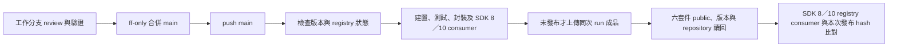

# 初期 CI/CD 與公開 Preview 發布規則

2026-10-21，依負責人本次決定生效；取代上一輪「先經 PR／Environment 核准再發布」提案。

## 已決定的規則

- 六個現行套件均採 **public**；舊 Messaging.Abstractions 不新增轉接版本。
- 版號不自動遞增。2026-10-22 負責人明確核准核心工作使用 `0.0.3-preview`；前次為 `0.0.2-preview`。Gate 必須讀回 registry，確認選定版本是否存在；不能只依本機判斷未發布。
- 初期在工作分支完成 review 與必要驗證，使用 `git merge --ff-only` 回 main，然後直接推送 main。
- **main push 觸發完整建置、測試、封裝、發布與 registry 驗證**。不另要求 PR、required reviewers 或新增 branch protection。
- 暫不建立 tag／GitHub Release，也不以 tag 觸發；後期再評估其他觸發與治理方式。
- 發布來源仍為 GitHub Packages，nuget.org 不在此次範圍。

## 執行流程

[Publish GitHub preview](../../.github/workflows/publish-preview.yml) 是 main push 的唯一建置／發布入口，
呼叫 [Package CI](../../.github/workflows/ci.yml)。Package CI 的獨立 push 觸發只保留 `codex/**`，
另外保留 PR／workflow_call；main 不重複執行另一份同樣的建置。

`PREVIEW_PUBLISH_ENABLED=true` 才通過發布 gate；此 variable 是維護者可用的停用開關。
Main gate 仍驗證 preview 版號與 LICENSE。只有 publish job 取得 `packages: write`，
使用 `GITHUB_TOKEN`；Environment 保留現有設定，沒有新增人工審批要求。
同一發布 concurrency group 串行且不中斷進行中的 run。

## 相同版本與部分失敗

`eng/Get-PreviewReleaseState.ps1` 使用具權限的 GitHub API，檢查六個 ID、repository linkage、
public 可見性及所有版本分頁。403 或其他 API 錯誤會失敗，只有 404 視為不存在。

| Registry 狀態 | 行為 |
|---|---|
| 六個 ID 都沒有目前版本 | CI 通過後上傳六個 nupkg；使用同次 run 的 artifact，先驗 SHA-256 |
| 六個 ID 都已有目前版本 | 仍執行 CI，跳過上傳，讀回並驗證已發布版本；不以新 build 覆寫舊版本 |
| 只有部分 ID 有目前版本 | 停止；保留最初 run 的 artifact，盤點已存在 bytes，再用原成品恢復缺少項目 |
| 既有 package 非 public、連結錯誤或權限不足 | 停止並回報，不能把 API 錯誤視為尚未發布 |

新版產品內容若需發布不同 bytes，必須先改用未發布的新版本；main push 不自動遞增版本。
同一目標的預覽修訂可用 `0.0.2-preview.1`、`.2`，正式版政策仍見[版號提案](version-policy-proposal.md)。
沒有使用 `--skip-duplicate`。六次 push 不是原子交易，不可刪除、覆寫或重建同版號後盲目重試。

上傳與 metadata verification 分為不同 jobs：上傳成功後若只因 metadata／可見性檢查失敗，
完成修正後可以 rerun failed jobs，不會重新執行已成功的上傳 job。
[Verify published GitHub preview](../../.github/workflows/verify-preview.yml) 也可手動執行唯讀驗證。
獨立 verify 依所選來源的版號與 inventory 工作，不會自動切回歷史四套件。

## Public 設定與驗證

本次已核准六套件 public。既有公開 package 的新版本沿用 package 可見性；
新的 Package ID 首次上傳後仍須確認。GitHub 文件指出新 package 預設 private，
可在 Package settings 改為 public；public 不能改回 private。
已查閱的官方 REST Packages API 未提供變更 visibility 的操作，因此 workflow 不使用未公開端點，
也不把上傳成功等同已公開。若新 ID 為 private，依本次授權在官方設定頁完成 public 設定後重跑驗證。
參考 [GitHub 可見性規則](https://docs.github.com/en/packages/learn-github-packages/configuring-a-packages-access-control-and-visibility)
與 [REST Packages API](https://docs.github.com/en/rest/packages/packages)。

新上傳成功時，registry consumer 在獨立 cache 還原六套件，逐一比對還原 nupkg 與同次 run artifact 的
SHA-256 及 `.nupkg.metadata` source，再完成 SDK 8／10 的六種消費模式。
已存在版本的後續 main run 不拿重新 build 的 bytes 與舊版本比較；只做 registry metadata 與消費行為驗證，
首次發布 bytes 的證據保留於原發布 run。獨立 verify 同樣不宣稱已執行 artifact hash 比對。

GitHub NuGet 的 public 套件安裝仍需要驗證；Actions 使用具存取權的 `GITHUB_TOKEN`，
本機使用適當 scope 的 PAT classic。見 [GitHub NuGet registry](https://docs.github.com/en/packages/working-with-a-github-packages-registry/working-with-the-nuget-registry)。

## 證據邊界與後期評估

合併前本機驗證、main hosted CI、push 成功、public metadata、registry consumer 是分開的結果。
本文件描述執行規則；實際版本結果分別記於 [0.0.3-preview 發布紀錄](0.0.3-preview.md) 與 [0.0.2-preview 歷史紀錄](0.0.2-preview.md)。
後期才評估 tag／Release、PR 與 branch protection、required reviewers、nuget.org 及正式版維護線；
這些不作為目前初期發布的前置條件。
