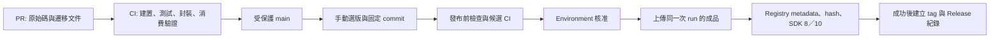

# 新版發布現況與 CI/CD 規劃

2026-10-21。現況取自 repository workflow、腳本與唯讀 GitHub API；建議項目尚未實作或啟用。
本次交付是 CT-004／CT-005 review、必要修正、本機驗證與目前分支 commit，不包含 push、merge 或發布。

## 目前實際規則

| 項目 | 已實作／查證 |
|---|---|
| 候選版號 | `Directory.Build.props` 手動設定 `0.0.2-preview`；本機六套件共用，沒有自動升版 |
| 遠端 main | 仍使用四套件 `0.0.1-preview` 的發布定義；本次六套件變更尚未推送 |
| CI 觸發 | PR、main 與 `codex/**` push，亦可由發布 workflow 呼叫 |
| CI 工作 | Release build、Analyzer 測試、ES .NET 8／10 測試、六套件檢查及 SHA-256；consumer 在 SDK 8／10 分別還原與執行六種模式（本次分支） |
| 發布觸發 | `Publish GitHub preview` 手動 dispatch，僅允許 main；輸入版號必須與來源相同且符合 `x.y.z-preview[.n]` |
| 發布開關 | 本次 API 讀回 `PREVIEW_PUBLISH_ENABLED=false`，目前不會通過發布 gate |
| 發布 gate | 檢查開關、main、版號、LICENSE 存在；來源／授權審查仍是人工前置責任，檔案存在不代表審查完成 |
| 成品來源 | 發布 run 的固定來源重新執行 reusable CI；下載同次 run 的 nupkg，驗 SHA-256 後上傳，不在 publish job 重打包 |
| 權限／並行 | 只有 publish job 有 `packages: write`，使用 `GITHUB_TOKEN`；同發布 concurrency group 串行且不中斷進行中發布 |
| 發布後 | 讀回 ID、版本、repository linkage 與 private 可見性；成功後以乾淨 cache 做 SDK 8／10 registry consumer |
| main 保護 | API 回應 `Branch not protected`，repository rulesets 為 `[]`；目前 CI 成功不是受伺服器強制的合併條件 |
| Environment | `github-packages-preview` 存在，`protection_rules=[]`、`deployment_branch_policy=null`；沒有 reviewer 或部署分支限制，main 限制來自 workflow gate |
| Tag／Release／正式來源 | 沒有 tag 觸發發布、GitHub Release 建立或 nuget.org 上傳步驟；正式版政策仍待決定 |

現行定義：[CI](../../.github/workflows/ci.yml)、[發布](../../.github/workflows/publish-preview.yml)、
[已發布驗證](../../.github/workflows/verify-preview.yml)、[版號提案](version-policy-proposal.md)。
「六套件、ES 測試、新的 consumer」是本次本機分支的定義，不表示遠端已執行。

## 發布前尚未解除的落差

1. **可見性預期與已發布紀錄不同。** [0.0.1 紀錄](preview.md)記載四個舊 ID 為 public，
   workflow 卻固定要求 private。本輪 package metadata API 因目前 CLI 憑證缺少 `read:packages`
   回傳 403，沒有取得新的套件狀態，亦未擴增憑證權限。
   GitHub 文件明定 public 套件不能改回 private，因此不能把「改回 private」當成既有 ID 的修復方案。
   見 [GitHub 可見性規則](https://docs.github.com/en/packages/learn-github-packages/configuring-a-packages-access-control-and-visibility)。
2. **發布後才檢查可見性。** 若現在只打開開關，可能上傳成功後才遇到相同錯誤。
   新版三個沿用的 ID（Analyzer、Domain、Application）及三個新 ID（Messaging、Application.Messaging、Domain.EventSourcing）
   必須分別處理，不能因為是新版本就假設既有 package 的可見性會重設。
3. **main 與 Environment 尚未強制流程。** 手動 dispatch 與 workflow 中的 if／throw 已存在，
   但「必須經 PR、CI 成功、發布核准」尚未全由 GitHub 設定強制。
4. **Registry consumer 尚未對照發布 artifact 的 SHA-256。** 現行 source mapping 與乾淨 cache 可驗證來源選擇及安裝行為；
   本機 artifact 的 checksum 驗證不能代替 registry 下載 bytes 與該 artifact 的逐一比對。
5. **獨立 verify 綁定所選來源版號／inventory。** 用新來源執行只會查新版本六套件；
   需驗舊四套件時須選用對應舊來源，或在後續實作加入明確的 release 來源選擇。

## 建議版號規則

目前維持 `0.0.2-preview`；相同目標的後續預覽修訂用 `0.0.2-preview.1`、`.2`。
產品階段改變或另開下一個目標時，再決定 `0.0.3-preview` 等基線；不要讓 CI 每次 build 自動消耗發布版號。
0.x 的破壞性變更仍須提供完整遷移說明，不能以 patch 數字表示向下相容承諾。
六套件暫時共同發布，但各自可獨立採用；不發布舊 Messaging.Abstractions 的假轉接版。
正式版建議採產品 SemVer，支援的 .NET 版本以獨立矩陣描述；此建議尚未取代既有暫緩決策。

## 建議流程與實作順序

### 第一階段：先完成發布決策與遠端門檻

- 決定六個現行 ID 的公開範圍。若產品延續既有 public 發布，建議六個都以 public 為目標，
  明確授權新 package 的公開轉換；若確實需要 private，另選未公開過的 package 身分／命名空間，
  把新增遷移成本列入決策。此次不替負責人變更可見性。
- 為 main 設定 PR 與實際 CI job context 的 required checks；context 以首次六套件 hosted run 的名稱確認。
- Environment 限 main，設定適合實際維護人員的 required reviewers；先確認帳戶與 repository 支援。
  [GitHub Environment 規則](https://docs.github.com/en/actions/how-tos/deploy/configure-and-manage-deployments/manage-environments)
  說明引用 environment 的 job 才受其保護。開關只在條件完成並核准該次發布時啟用。

驗收：未通過必要 CI 的 PR 不能正常合併；非 main 或未經所需核准的發布 job 不能開始；設定均有 API 讀回。

### 第二階段：修正現有三個 workflow，不另建發布平台

- 保留現有 Package CI 與 .NET 8／10 consumer；支援矩陣、公開 API、封裝邊界有變更才增加相應測試。
- 將六套件 inventory 與預期可見性收斂為一個共用設定，供 pack、publish、verify 使用，避免再次漏改名稱。
- Publish 在任何 push 前檢查六個 ID／version、已存在 package 的 visibility／repository linkage、來源 commit 與 candidate metadata。
  僅 404 可視為不存在；403／網路錯誤應停止，不能當成新 package。
- 新 ID 若目標 public，將新建 package 的公開動作納入已核准發布步驟，隨後讀回；不宣稱 preflight 能預先證明尚不存在的 package 可見性。
- 保留同次 run 的已測 nupkg 與 checksum，逐一檢查實際 registry 下載 nupkg 的 SHA-256、
  `.nupkg.metadata` 來源、版本、linkage、可見性，最後執行兩個 SDK 的 consumer。
- 使用同一發布來源與 inventory 進行無寫入的 verify；核准欄位及 artifact 保留期限直接使用 GitHub 能力，不新增自製狀態平台。

驗收：版本已存在、可見性不符、權限不足都在第一個 push 前失敗；
成功路徑六套件全數比對 registry bytes 並通過兩個 SDK；上傳後失敗則清楚列出已上傳項目與未完成驗證。

### 第三階段：發布紀錄與重試

- 六套件驗證成功後，為已驗證來源建立 `v0.0.2-preview` tag 與 prerelease Release，附上來源 SHA、
  workflow run、六套件 checksum、相容性與遷移說明。tag 作為成功發布紀錄，不再觸發第二次上傳。
- 六次 NuGet push 不是原子交易。部分上傳時保留該 run 的 artifact；先讀回既有 ID/version 與 hash。
  只有 hash 相同才可將項目視為已完成，缺少的項目由受控恢復流程使用原 bytes 補傳；
  hash 不同立即停止，需修復內容則升新版本。不得用 `--skip-duplicate` 掩蓋差異或移動既有 tag。
- 驗證或 Release 紀錄失敗可單獨重跑讀回／紀錄，不重新 build 或 push 已存在版本。
- nuget.org 保留為正式版前的獨立階段，另定 ownership、授權與發布憑證；這次不擴張發布來源。

驗收：相同 ID/version 永不覆寫；部分成功可從原 artifact 恢復；Release/tag 指向已驗證來源，
失敗不能誤記為完整發布成功。

GitHub Packages 的 NuGet 安裝即使 public 也需要驗證；Actions 可使用具相應存取權的 `GITHUB_TOKEN`，
本機可使用適當 scope 的 PAT classic。見 [GitHub NuGet registry](https://docs.github.com/en/packages/working-with-a-github-packages-registry/working-with-the-nuget-registry)。

以上階段為可供後續實作的提案。本輪沒有建立 ruleset、修改 Environment／開關、派送 workflow、建立 tag 或上傳套件。
