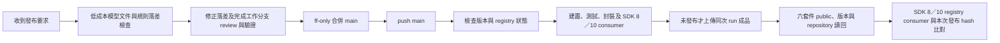

# 初期 CI/CD 與公開 Preview 發布規則

本文件定義現行公開 Preview 發布流程。首次不帶 `-preview` 後綴的公開版本另須滿足[版本政策與文件閘門](version-policy-proposal.md)；現有 pipeline 仍只接受 preview，不因文件要求而自動具備正式版發布能力。

## 已決定的規則

- 六個現行套件均採 **public**；舊 Messaging.Abstractions 不新增轉接版本。
- 版號由具體發布決策選定，不自動遞增。Gate 必須讀回 registry，確認選定版本是否存在；不能只依本機判斷未發布。
- 初期在工作分支完成 review 與必要驗證，使用 `git merge --ff-only` 回 main，然後直接推送 main。
- **main push 觸發完整建置、測試、封裝、發布與 registry 驗證**。不另要求 PR、required reviewers 或新增 branch protection。
- 暫不建立 tag／GitHub Release，也不以 tag 觸發；後期再評估其他觸發與治理方式。
- 發布來源仍為 GitHub Packages，nuget.org 不在此次範圍。

## 發布要求觸發的文件與規則檢查

收到使用者的發布要求後，執行 AI 必須主動完成本節檢查，不等待使用者逐項提醒；在可能觸發上傳的 main push 或其他發布動作之前完成。適用 Preview 與正式版，單純詢問發布策略不等於要求立即發布。這是專案協作要求，目前 GitHub Actions 尚未自動執行 AI 語意審查。

### 模型與成本

文件／規則落差檢查使用低成本模型。使用者指定的允許候選為 GPT 6.1 SOL、GPT 6.1 Terra、Claude Sonnet 5.5、Claude Haiku 5.5，或經當下 provider 資訊確認屬同級低成本的較新模型；這份清單不是價格或可用性保證。執行時確認宿主支援的精確模型 ID，記錄實際模型及可觀察的執行識別，不以顯示名稱猜測 API ID，也不自行宣稱某候選最便宜。

目前執行模型符合條件時可直接檢查；否則使用宿主支援的指定模型委派。此用途允許有界的低成本審查子代理，不要求安裝 Framework sub-agent profiles 或跨 provider 整合。無法指定或確認模型時，先完成非 AI 的差異與連結檢查，將語意檢查標為未完成，請使用者切換至可用低成本模型或明確同意替代方案；不得默默改用昂貴模型，也不得省略檢查後發布。

預設一次有界審查：給定發布基線、候選 commit、diff、文件入口及必要來源，由變更影響擴展閱讀。先用機械檢查縮小範圍，不整庫重讀、不重建完整 SDLC、不重跑無關昂貴驗收。修正後只複查受影響項目；遇到實質政策衝突或證據不足才升級討論，不以多輪模型投票代替證據。

### 檢查範圍與交付

1. 固定遠端／本機身分、工作樹狀態、最近實際發布來源與候選 commit、目標版號及套件 inventory。以發布基線到候選的完整差異為範圍，不能只看上一筆提交；無法確認基線時揭露缺口，不猜測。
2. 每次核對 README、使用指南、版本政策及發布說明中的版本、安裝方式、平台、套件 ID 與交付能力。依變更追查 Diagnostic 文件、規則設計理由、方法論來源、產品決策／PRD、`rules/catalog.xml`、schema、Analyzer predicate、公開契約／API XML、測試與 samples；交叉比對預設值、Profile、severity、角色辨識、限制及驗收聲明，不只檢查連結存在。
3. 檢查實際 pack 輸入、隨包 README／XML 與發布紀錄是否一致，依[合併與升版判準](version-policy-proposal.md#合併與升版判準)判定升版。原始碼文件、封裝內容與 feed consumer 可讀性分別留證；發布前不能預填發布成功。正式版另覆蓋全部正式版文件閘門，Preview 不必等待所有未來能力完成，但當版說明必須正確。
4. 回報候選 SHA、基線、實際模型、已檢查範圍、未評估範圍及逐項落差。每項提供檔案位置、對照證據、影響、修正方向及是否阻擋本次發布；結果在現有對話／工作紀錄呈現，正式版本紀錄僅保存產品交付與技術驗證證據，不建立平行規則台帳。
5. 已確認的當版說明錯誤、規則與實作不一致、誤稱驗收通過，以及缺少必要發布證據，須修正或釐清後才發布。發布要求涵蓋必要且不改變已接受政策的文件修正；不得為消除落差而自行改 Analyzer 行為或放寬政策。已揭露且不影響當版交付正確性的後續工作可保留，不能把所有 open Issues 都當阻擋。
6. 修正後讀回 diff、連結與必要行為證據，固定最終候選 SHA。候選內容再變更時複查受影響範圍；通過後沿既有授權繼續發布，不重複索取已授權步驟的許可。無法完成必要檢查則明確回報未完成，不以 CI 綠燈代替語意審查。

## 執行流程

[Publish GitHub preview](../../.github/workflows/publish-preview.yml) 是 main push 的唯一建置／發布入口，
呼叫 [Package CI](../../.github/workflows/ci.yml)。Package CI 的獨立 push 觸發只保留 `codex/**`，
另外保留 PR／workflow_call；main 不重複執行另一份同樣的建置。

`PREVIEW_PUBLISH_ENABLED=true` 才通過發布 gate；此 variable 是維護者可用的停用開關。
Main gate 仍驗證 preview 版號與 LICENSE。只有 publish job 取得 `packages: write`，
使用 `GITHUB_TOKEN`；Environment 保留現有設定，沒有新增人工審批要求。
同一發布 concurrency group 串行且不中斷進行中的 run。

## 相同版本與部分失敗

`eng/Get-PreviewReleaseState.ps1` 使用具權限的 GitHub API，檢查六個 ID、repository linkage、
public 可見性及所有版本分頁。403 或其他 API 錯誤會失敗，只有 404 視為不存在。

| Registry 狀態 | 行為 |
|---|---|
| 六個 ID 都沒有目前版本 | CI 通過後上傳六個 nupkg；使用同次 run 的 artifact，先驗 SHA-256 |
| 六個 ID 都已有目前版本 | 仍執行 CI，跳過上傳，讀回並驗證已發布版本；不以新 build 覆寫舊版本 |
| 只有部分 ID 有目前版本 | 停止；保留最初 run 的 artifact，盤點已存在 bytes，再用原成品恢復缺少項目 |
| 既有 package 非 public、連結錯誤或權限不足 | 停止並回報，不能把 API 錯誤視為尚未發布 |

新版產品內容若需發布不同 bytes，必須先改用未發布的新版本；main push 不自動遞增版本。文件整合、隨包內容更新與產品行為變更的升版判斷，統一依[合併與升版判準](version-policy-proposal.md#合併與升版判準)。
首個不帶 `-preview` 公開版本之前不考慮向後相容，可直接調整 ID、schema、defaults 與 API；不強制 legacy／replacement／migration scaffolding。具體政策與正式版文件閘門見[版本政策](version-policy-proposal.md)。
沒有使用 `--skip-duplicate`。六次 push 不是原子交易，不可刪除、覆寫或重建同版號後盲目重試。

上傳與 metadata verification 分為不同 jobs：上傳成功後若只因 metadata／可見性檢查失敗，
完成修正後可以 rerun failed jobs，不會重新執行已成功的上傳 job。
[Verify published GitHub preview](../../.github/workflows/verify-preview.yml) 也可手動執行唯讀驗證。
獨立 verify 依所選來源的版號與 inventory 工作，不會自動切回歷史四套件。

## Public 設定與驗證

六個現行套件採 public。既有公開 package 的新版本沿用 package 可見性；
新的 Package ID 首次上傳後仍須確認。GitHub 文件指出新 package 預設 private，
可在 Package settings 改為 public；public 不能改回 private。
已查閱的官方 REST Packages API 未提供變更 visibility 的操作，因此 workflow 不使用未公開端點，
也不把上傳成功等同已公開。若新 ID 為 private，須在該次發布的具體授權範圍內完成官方 public 設定並重跑驗證。
參考 [GitHub 可見性規則](https://docs.github.com/en/packages/learn-github-packages/configuring-a-packages-access-control-and-visibility)
與 [REST Packages API](https://docs.github.com/en/rest/packages/packages)。

新上傳成功時，registry consumer 在獨立 cache 還原六套件，逐一比對還原 nupkg 與同次 run artifact 的
SHA-256 及 `.nupkg.metadata` source，再完成 SDK 8／10 的六種消費模式。
已存在版本的後續 main run 不拿重新 build 的 bytes 與舊版本比較；只做 registry metadata 與消費行為驗證，
首次發布 bytes 的證據保留於原發布 run。獨立 verify 同樣不宣稱已執行 artifact hash 比對。

GitHub NuGet 的 public 套件安裝仍需要驗證；Actions 使用具存取權的 `GITHUB_TOKEN`，
本機使用適當 scope 的 PAT classic。見 [GitHub NuGet registry](https://docs.github.com/en/packages/working-with-a-github-packages-registry/working-with-the-nuget-registry)。

## 證據邊界與後期評估

合併前本機驗證、main hosted CI、push 成功、public metadata、registry consumer 是分開的結果。
本文件描述執行規則；實際版本結果分別記於 [0.0.3-preview 發布紀錄](0.0.3-preview.md) 與 [0.0.2-preview 歷史紀錄](0.0.2-preview.md)。
後期才評估 tag／Release、PR 與 branch protection、required reviewers、nuget.org 及正式版維護線；
這些不作為目前初期發布的前置條件。

首個不帶 `-preview` 的公開版本另需逐規則設計理由、完整套件使用說明，以及有語意且隨 `.nupkg` 交付、由 consumer 可讀的 API XML 證據。這是待落實的產品 gate，並非現有 preview workflow 已自動檢查或本次已通過；正式版發布機制需另行實作與驗證。
